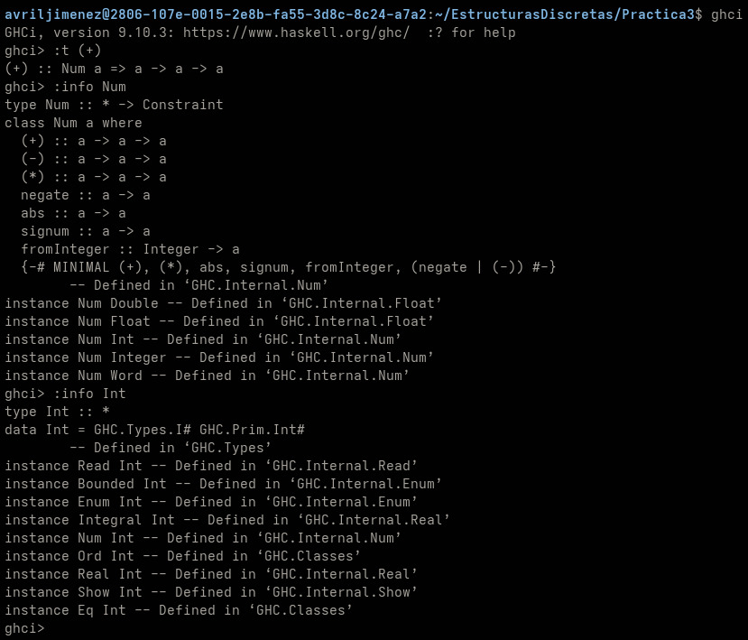

## objetivo de la practica
crear funciones por listas de comprension, entenderla y tambien hacer el uso de los modulos y llamarlos desde otro archivo .hs
## tiempo requerido
aproximadamente 4 dias ya que lo fui haciendo parcialmente
## ejercicio favorito
me gusto hacer la funcion de negativos, usar las listas por conprension me gusta, asi que los demas que en los que tambien use las listas igual me gustaron (con exepcion de la funcion coprimos ya que se me dificulto un poco)
## cual es la diferencia entre Num e Int?
num es una clase de tipos por ejemplo (+,-,*), mientras que Int representa solo a los numeros enteros (1,2.3...)
